 

 

 &nbsp;  &nbsp;

---

## ✦ A little about me

Hey! I'm **Ahmed Mohamed Taha**, a Full Stack Developer from Egypt. I enjoy the process of taking an idea from a rough thought and turning it into something people can actually use.

For me, development isn't just writing code. It's understanding a problem, breaking it into smaller pieces, choosing the right tools, and shaping a solution that feels simple from the outside — even when there's a lot happening behind the scenes.

I'm interested in the whole journey of building software: the look and feel of an interface, the logic that powers it, the data behind it, and the details that make an application useful. I like exploring different ways to build things, learning through experiments, and getting better with every project.

> **In a world full of chaos, I build logic.**

### What I enjoy building

<table>
  <tr>
    <td width="50%">
      <h3>🌐 Web Experiences</h3>
      Modern, responsive websites and web applications that feel clear, fast, and easy to use.
    </td>
    <td width="50%">
      <h3>⚙️ Software & Applications</h3>
      Practical applications that turn everyday needs and ideas into useful digital tools.
    </td>
  </tr>
  <tr>
    <td width="50%">
      <h3>🖥️ Desktop Software</h3>
      Exploring desktop applications and software beyond the browser.
    </td>
    <td width="50%">
      <h3>🧠 Problem Solving</h3>
      Breaking complicated problems down and finding clean, logical ways to solve them.
    </td>
  </tr>
</table>

### The way I approach development

- **Build with purpose:** I want the things I create to solve a real problem.
- **Keep it clear:** I appreciate readable code, thoughtful structure, and simple user experiences.
- **Stay curious:** Technologies change, so I keep exploring and learning.
- **Improve through practice:** Every experiment and project is a chance to become better.

`Curiosity → Learning → Building → Improving`

---

## ✦ Technologies I work with

### Frontend

  
  
  
  
  
  
  
  
  

### Backend

  
  
  

### Databases & Services

  
  
  

### Tools I use

  
  
  
  
  

---

## ✦ GitHub in numbers

 

 

---

### Thanks for visiting ✦

**Keep learning. Keep building. Keep improving.**

